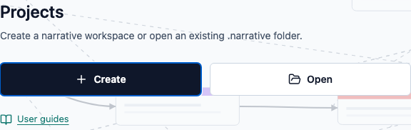

# Your first story

Start with a small event and two possible endings. You do not need a Scene to
write a story; add Scenes later when grouping becomes useful.

## Create a project

1. On the start screen, choose **Create**.
2. Enter a name, such as **The Locked Gate**, and an optional description.
3. Keep the suggested parent directory or choose another folder. For a first
   project, keep local storage; AI assistance is optional.
4. Choose **Create**. The workspace opens on your new project.

## Add the first action

1. Open the project sidebar and create a Story Flow named **The Gate**.
2. Switch to **Flow**. Use an offered starter action to add an Event.
3. Name it **Arrive at the gate** and write what the reader sees.
4. Use **Continue from** on that element. Create a new Event named **Enter**.
5. Continue again from the first element to a second Event named **Leave**.
6. Give the two transitions meaningful labels. Use branching transitions for
   alternatives rather than drawing ordinary relationships.

The first element is the flow entry. Follow the arrows to check the order.

## Read and try the result

- **Graph** is the workspace for arranging the story's elements and relationships.
- **Flow** shows the selected story's order and branches.
- **Story** presents that story as text.
- The Play button starts **Playback**, where you can try available choices.

Try both endings. Use Back or Restart in Playback to explore another route.
Playback does not rewrite your authored story. Return to authoring to edit it.

## Save and continue

Choose **Save** in the header. When closing a changed project, choose Save to keep
the changes, Discard to return to the last save, or Cancel to keep working.

Next: [projects and saving](projects.en.md) and [working on the graph](canvas.en.md).
