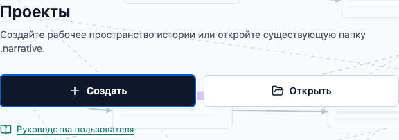

# Первая история

Начните с небольшого события и двух возможных концовок. Сцена не обязательна:
добавьте её позже, если понадобится объединить элементы в группу.

## Создайте проект

1. На стартовом экране нажмите **Создать**.
2. Введите название, например **Запертые ворота**, и при желании описание.
3. Оставьте предложенную родительскую папку или выберите другую. Для первого
   проекта используйте локальное хранение; помощь ИИ не обязательна.
4. Нажмите **Создать**. Откроется рабочее пространство проекта.

## Добавьте первое действие

1. Откройте боковое меню проекта и создайте поток истории **Ворота**.
2. Перейдите в **Поток**. Используйте предложенное начальное действие для события.
3. Назовите его **Подойти к воротам** и опишите, что видит читатель.
4. Через действие продолжения создайте новое событие **Войти**.
5. Ещё раз продолжите первое событие, создав второй вариант **Уйти**.
6. Подпишите переходы понятными фразами. Для альтернатив используйте ветвление,
   а не обычные смысловые связи между элементами.

Первый элемент служит началом потока. Проверьте порядок по стрелкам.

## Прочитайте и проверьте результат

- **Граф** нужен для размещения элементов истории и смысловых связей.
- **Поток** показывает порядок и развилки выбранной истории.
- **История** представляет её в текстовом виде.
- Кнопка запуска открывает **Прохождение**, где можно выбирать доступные варианты.

Попробуйте обе концовки. Вернитесь назад или начните прохождение заново, чтобы
выбрать другой путь. Прохождение не переписывает историю: для правок вернитесь
в рабочее пространство.

## Сохраните работу

Нажмите **Сохранить** в верхней панели. При закрытии изменённого проекта выберите
сохранение, сброс изменений до последнего сохранения или отмену закрытия.

Далее: [проекты и сохранение](projects.ru.md) и [работа с графом](canvas.ru.md).
